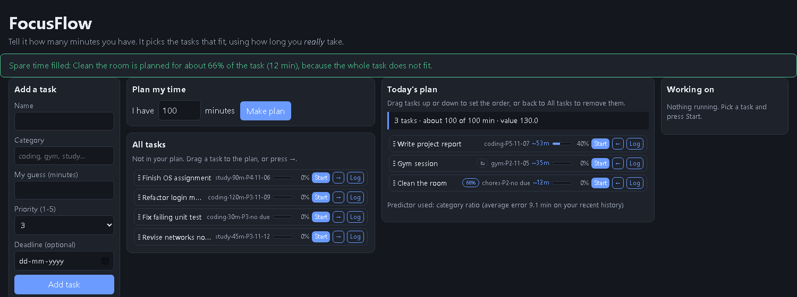
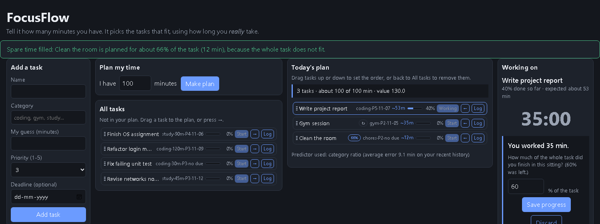

# FocusFlow

A time-budgeted task planner. You say **"I have 60 minutes"**; it picks the set of tasks that fits.
It also learns how long you *really* take compared with your own guesses, so plans stay realistic.

Four columns: add tasks and daily tasks | plan form and all tasks | today's plan | the task you are working on
(with its stopwatch). Each task is one compact line. **Make plan** moves the chosen tasks into the plan column, and you can
drag tasks between "All tasks" and "Today's plan" (or use the arrow buttons) and drag them up or down inside the plan to set the order; the plan shows
its total minutes against your time and turns red if you go over.



After Stop or Finish it asks how much of the task you got done, and the answer trains the predictor:



*(Screenshots use simulated demo data from `simulator/seed_demo.py`.)*

## How it works

```
Browser (plain HTML/JS)  ->  FastAPI (Python)  ->  ctypes  ->  C++ engine (shared library)
                                  |
                               SQLite
```

1. **Work with the stopwatch.** Press Start on a task (from the plan or the task list) and use Pause / Resume / Stop / Finish.
   The timer survives a page refresh. When you stop it asks what share of the task you finished in that sitting.
   Stopped halfway? The task stays on your list at its new %, and the sitting is stored as unfinished.
   A sitting that finished P% in M minutes counts as evidence that the whole task takes `M * 100 / P` minutes.
2. **Predict real time** (`engine/src/predictors.cpp`, `selector.cpp`). Three kinds of predictor:
   your raw guess, a per-category ratio (`actual / guessed`), and a weighted k-nearest-neighbours predictor
   (distance = category mismatch + gap between the logs of the guessed sizes). The selector grades six
   candidates (raw, ratio, KNN with k = 1, 2, 3, 5) on the newest 30% of your history, in time order, and keeps
   the lowest error. Ties keep the simpler model. With fewer than 10 sessions it skips the comparison and uses the ratio.
3. **Score each task** (`backend/scoring.py`). `value = priority * 10 + 30 / (1 + days_left)`, so the closer the deadline, the more a task is worth.
4. **Plan** (`engine/src/planner.cpp`). A 0/1 knapsack (dynamic programming, full table so the chosen tasks can be recovered)
   picks the set with the most total value that fits in your minutes. Only the *remaining* part of a half-done task costs time.
   The knapsack only takes whole tasks, so a gap is usually left. `backend/fill.py` fills it with a slice of the left-out task
   with the best value per minute ("do about 40% of it"), if the gap is at least 5 minutes and the slice at least 5% of the task.
5. **Daily tasks** repeat automatically: a template makes today's copy the first time the app is used each day (no background scheduler).

The C++ code is compiled into a shared library (`focusflow.dll` on Windows, `libfocusflow.so` on Linux) and called from
Python with `ctypes`. Python cannot pass C++ vectors or strings, so `engine/src/c_api.cpp` exposes two functions
that take flat arrays (`ff_predict`, `ff_plan`).

## Run it

Needs: g++ (C++17), Python 3.11+, and `pip install -r backend/requirements.txt`.

Windows, one command from the repo root (builds the engine the first time, starts the server, opens the browser):

```powershell
.\run.ps1
```

Or step by step:

```powershell
# Windows (from engine/): runs the C++ tests, then builds build\focusflow.dll
.\build.ps1
```
```bash
# Linux / macOS (from the repo root)
bash engine/build.sh
```
```bash
# then, from backend/
python -m uvicorn main:app --reload     # open http://127.0.0.1:8000
```

Try it with demo data instead of an empty list:
`python simulator/seed_demo.py demo.db`, then start the server with the environment variable `FOCUSFLOW_DB=demo.db`.
Open `http://127.0.0.1:8000/?plan=60` to see a finished plan straight away.

## Tests

| What | Command | Tests |
|---|---|---|
| C++ engine | `engine\build.ps1` or `bash engine/build.sh` | unit tests (predictors, selector, planner) |
| API + database | `python -m pytest -q` in `backend/` | 42 |
| Stopwatch logic (JS) | `node frontend/test_timer.js` | pause/resume/stop maths, clock text |
| C++ vs Python port agree | `python -m pytest -q` in `benchmark/` | 2 |

GitHub Actions (`.github/workflows/ci.yml`) runs all four on every push. The click-through of the page itself
(plan, Start, Pause, Resume, reload, Stop, save, Finish, Discard) was checked by hand in a real browser, not in CI.

## Results

> **These come from simulated users, not real people.** The simulator (`simulator/simulate.py`) invents users whose
> real times follow patterns I chose (study tasks take 1.4x the guess, long coding tasks overrun by up to 1.7x, plus
> random wobble). The numbers show the engine *learns patterns that exist*. They are not a claim about how real
> people behave, and the coding pattern is one the KNN predictor is designed to catch. Full details and tables:
> [`simulator/results.md`](simulator/results.md). 30 users, fixed seeds, repeatable.

**Users who misjudge their time**

| | Your own guesses | FocusFlow |
|---|---|---|
| Average prediction error (160 sessions of history) | 27.2 min | **12.8 min** (-53%) |
| Average prediction error (40 sessions) | 27.2 min | **13.5 min** (-50%) |
| Plans that overran the time available | 76% | **23%** |
| Value actually completed (best possible = 100%) | 87% | **94%** |

**Control: users whose guesses are already accurate.** FocusFlow does *not* help here, and with little history it is slightly
*worse* than the raw guess (prediction error +23% at 10 sessions, +5% at 40, equal at 160). The selector often keeps the
raw guess for these users, but the early sessions are noisy. A real product should show the user's own guess until it has
enough history.

### Speed: C++ vs a pure-Python port

The same algorithms written in plain Python (`benchmark/py_engine.py`, checked to give identical answers) against the C++
engine called through ctypes. Median of repeated runs on one Windows machine; yours will differ.

| Operation | Python | C++ via ctypes | Speed-up |
|---|---|---|---|
| predict, 100 history rows, 20 tasks | 7.0 ms | 0.5 ms | 14x |
| predict, 500 history rows, 20 tasks | 165 ms | 6.5 ms | 25x |
| predict, 2000 history rows, 20 tasks | 2733 ms | 92 ms | 30x |
| plan, 50 tasks, 480-minute budget | 4.7 ms | 0.06 ms | 74x |
| plan, 500 tasks, 1440-minute budget | 174 ms | 1.7 ms | 100x |

Honest note: for a single person's task list (tens of tasks) *both* are fast enough that nobody would notice. The C++
engine matters when history or task counts grow large, and it was a deliberate choice to learn how to bridge the two languages.

## Limitations

- Accuracy is only measured on simulated data. Real validation needs real logs from real users.
- The "% finished" figure is the user's own estimate, so unfinished sessions give noisier training data than finished ones.
- Single user, no login, no time zones: dates come from the server's clock.
- Plans use whole minutes, and tasks cannot be split except through the partial-progress feature.

## Layout

```
engine/       C++ engine: src/ (predictors, selector, planner, c_api), tests/, build scripts, old/ (earlier version, unused)
backend/      engine.py (ctypes bridge), db.py (SQLite), scoring.py, main.py (FastAPI), test_api.py
frontend/     index.html, style.css, app.js (page), timer.js (stopwatch logic) + test_timer.js (no framework)
simulator/    simulate.py (results), seed_demo.py (demo data)
benchmark/    py_engine.py (Python port), bench.py, test_equivalence.py
learn/        the step-by-step teaching programs that led to the engine
```
